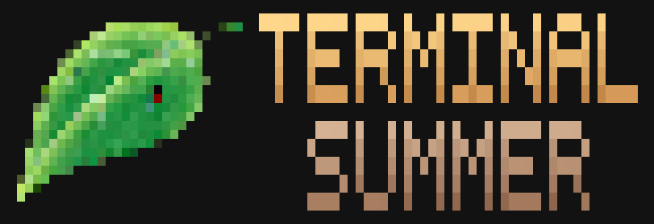

# Terminal Summer

Адаптация визуальной новеллы «Бесконечное лето» для терминала. Сцены, фоны и персонажи отображаются в ANSI/ASCII, а интерфейс работает прямо в консоли.

Python, терминальная графика и эксперимент с привычным игровым интерфейсом.

## Стек

- Python / Textual / Rich
- Pillow / pil2ansi

[Открыть проект на GitHub ↗](https://github.com/dydojopka/Terminal-Summer)
